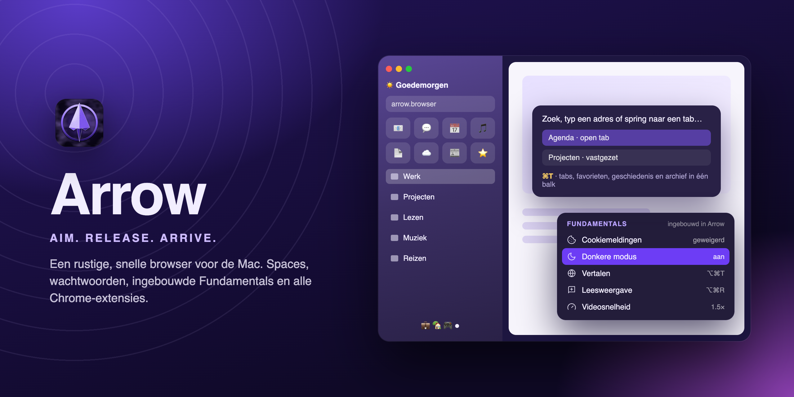

<a href="README.md">🇬🇧 English</a> · <b>🇳🇱 Nederlands</b>

  

<h1 align="center">Arrow</h1>

<b>Aim. Release. Arrive.</b> Een rustige, snelle browser voor de Mac.

  
  

  
  
  
  
  
  

---

## Wat is Arrow?

Arrow is een browser voor de Mac, gebouwd rond hoe je echt werkt. Werk en privé lopen nooit door elkaar, je vaste sites staan binnen één klik, en tabs ruimen zichzelf op. Onder de motorkap draait Chromium, dezelfde motor als Chrome, dus elke site en elke Chrome-extensie werkt gewoon.

## Installeren

| | |
|---|---|
| **.dmg** | Open het bestand en sleep **Arrow** naar **Programma's**. |
| **.pkg** | Dubbelklik en volg de stappen; Arrow komt vanzelf in Programma's. |

Bij de eerste start helpt een korte welkomst je op weg. Je kunt daar meteen je bladwijzers, geschiedenis en wachtwoorden importeren uit **Chrome, Safari, Firefox, Edge** of **Brave**.

> Arrow is ondertekend met een Apple Developer ID en door Apple genotariseerd. Je krijgt dus geen waarschuwing bij het openen.

## Functies

| | |
|---|---|
| 🪐 **Spaces** | Aparte werelden voor werk en privé, elk met eigen logins, cookies en extensies. Wisselen met de bolletjes onderin, een veeg of de duimknoppen van je muis. |
| ⚡ **Commandobalk** | Druk **⌘T**: zoeken, een adres typen of naar een open tab springen. Hij vult aan terwijl je typt, rekent (`12*7`), rekent eenheden en valuta om (`50 usd in eur`) en voert acties uit (`qr`, `donker`, `pipet`). |
| ⭐ **Favorieten en mappen** | Je vaste sites als tegels, met een eigen naam, emoji of afbeelding. |
| 🪟 **Split view en Peek** | Twee sites naast elkaar, of een link even laten zweven zonder je tab te verliezen. |
| 🕶️ **Privévenster** | **⇧⌘N**: er wordt niets bewaard, alles is weg als je het sluit. Per ongeluk een tab gesloten? **⇧⌘T** haalt hem terug. |
| 🐣 **Little Arrow** | Links uit Outlook, Teams of Slack openen in een klein los venster. |
| 💼 **Werk- en privémodus** | Eén klik opent je startset. Per modus bepaal je welke sites je mogen storen en welke even op pauze gaan. |
| 🔐 **Wachtwoorden** | Bewaren, invullen en sterke wachtwoorden voorstellen. Bekijken met Touch ID. |
| 📸 **Schermafbeelding en opname** | Zoals op macOS, met een editor om te markeren, bij te snijden of een video in te korten. |
| 🧩 **Alle Chrome-extensies** | Uit de Chrome Web Store, met een zijpaneel zoals in Chrome, en een ontwikkelaarsmodus voor je eigen extensies. |
| 🎨 **Jouw stijl** | Zes thema's, drie stijlen voor je tegels, Nederlands of Engels. |

## Fundamentals

Waar je normaal een extensie voor installeert, zit er gewoon in. Je vindt het in het menu **Fundamentals** en onder het puzzelstukje in de zijbalk, waar je ook ziet of het op de huidige pagina werkt. Het draait alleen als je het gebruikt, dus Arrow blijft licht.

| | |
|---|---|
| 🍪 **Cookiemeldingen** | Automatisch geweigerd ("Alles weigeren" / "Alleen noodzakelijk"), met een keuze per site. |
| 🌙 **Donkere modus voor sites** | Lichte sites worden donker; sites met een eigen donker thema blijven zoals ze zijn. **⇧⌘D** per site. |
| ⏩ **Videosnelheid en volume** | Elke video sneller of langzamer (**⌃.** / **⌃,**) en een volume per tab, ook vanuit de miniplayer. |
| ↻ **Automatisch herladen** | Een tab elke 30 seconden tot elk uur verversen, of je eigen tijd. Nooit terwijl je typt. |
| 🎨 **Kleurpipet** | **⇧⌘I**: wijs een kleur aan op de pagina, de hex-code staat op je klembord. |
| 📱 **QR-code** | De pagina naar je telefoon, gemaakt op je eigen Mac. |
| 📝 **Markdown-link** | **⌥⇧⌘C**: `[titel](url)`, of een klikbare link als je plakt in Notion, Mail of Word. |
| 📜 **Hele pagina vastleggen** | De volledige pagina, scherp op Retina, inclusief afbeeldingen die pas bij scrollen laden. |
| `{}` **JSON-weergave** | JSON-adressen als inklapbare boom met zoeken en kopiëren. |

## Veilig en privé

Arrow heeft geen account, geen telemetrie en geen advertentie-ID. Alles wat Arrow controleert, controleert hij op je eigen Mac.

- **Phishing- en malwarebescherming** met open lijsten (URLhaus, Phishing Army, OpenPhish), lokaal vergeleken. Er gaat geen enkel adres van jou naar buiten.
- **Altijd HTTPS.** Gewone http-adressen worden beveiligd geopend; lukt dat niet, dan zie je een duidelijke waarschuwing.
- **Versleuteld op schijf.** Logins en wachtwoorden staan versleuteld, met sleutels die alleen Arrow zelf kan lezen.
- **Toestemming op verzoek.** Een site kan je klembord niet lezen, geen andere apps openen en je camera niet gebruiken zonder het eerst te vragen.
- **Dichtgetimmerd.** Arrows eigen vensters laden nooit een website, en de app controleert zichzelf op aanpassingen.
- **Afgeschermd.** Elke site in een eigen proces en sandbox, en Arrow zelf draait met de hardened runtime van macOS.

## Snel

- Arrow legt al verbinding met een site als je over een bladwijzer beweegt, dus de pagina staat er sneller.
- Tabs die je een uur niet bekijkt geven hun geheugen terug, en blijven gewoon in de zijbalk staan.
- Grote downloads komen in meerdere delen tegelijk binnen.

## Updates

Je hoeft nooit zelf iets te downloaden. Arrow kijkt elke 3 uur of er een nieuwe versie is en installeert die als je hem afsluit. **Beveiligingsupdates** gaan altijd, **nieuwe functies** zoals jij wilt in *Instellingen → Updates*. Elke update moet met dezelfde Developer ID ondertekend zijn, anders weigert Arrow hem, en Arrow gaat nooit terug naar een oudere versie.

## Handige sneltoetsen

| Toets | Wat |
|---|---|
| **⌘T** | Nieuwe tab of naar een open tab springen |
| **⌘D** | Tab vastzetten of losmaken |
| **⌃1 … ⌃9** | Naar space 1 t/m 9 |
| **⌃⇧=** | Split view met de vorige tab |
| **⇧⌘N** | Nieuw privévenster |
| **⇧⌘T** | Gesloten tab heropenen |
| **⇧⌘2** / **⇧⌘5** | Schermafbeelding / schermopname |
| **⇧⌘D** | Donkere modus voor deze site |
| **⌃.** / **⌃,** | Video sneller / langzamer |
| **⌘/** | Alle sneltoetsen (en zelf aanpassen) |

## Vragen

<b>Werkt Arrow op een Intel-Mac?</b>
 Nog niet; Arrow is gebouwd voor Macs met Apple Silicon (M1 en nieuwer).

<b>Kan ik mijn wachtwoorden meenemen?</b>
 Ja. Uit Chrome, Edge en Brave direct bij het importeren; uit Safari, Firefox of 1Password via een CSV-export in <i>Instellingen → Wachtwoorden → Importeren</i>.

<b>Waar is de broncode?</b>
 Deze pagina bevat alleen de ondertekende releases van Arrow, niet de broncode.

---

Designed &amp; Developed by <b>Matthias Mann</b> · tips of vragen: matthiasmann175@gmail.com

